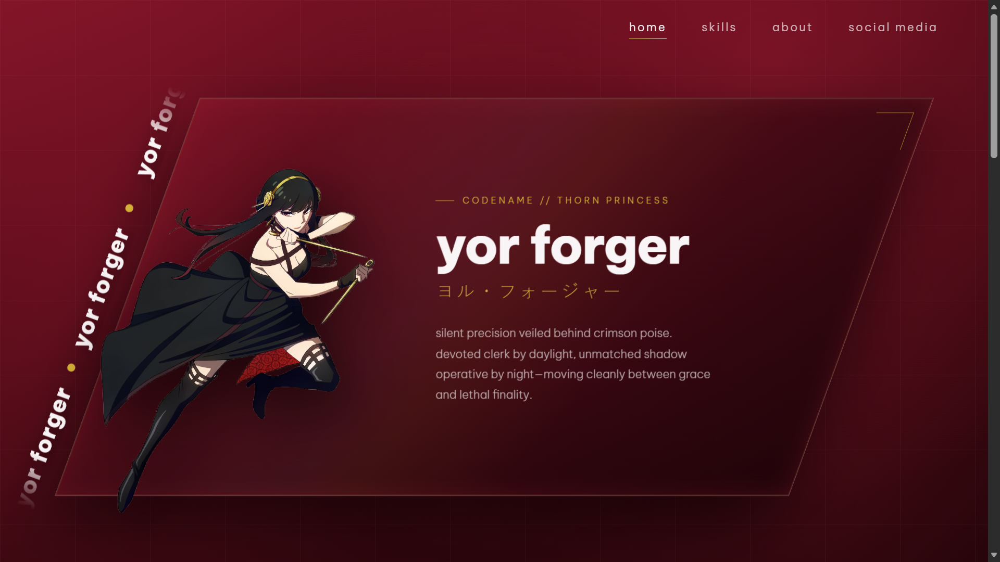
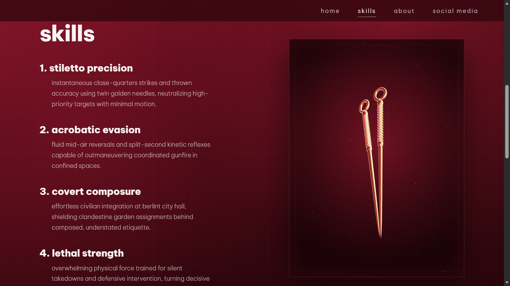
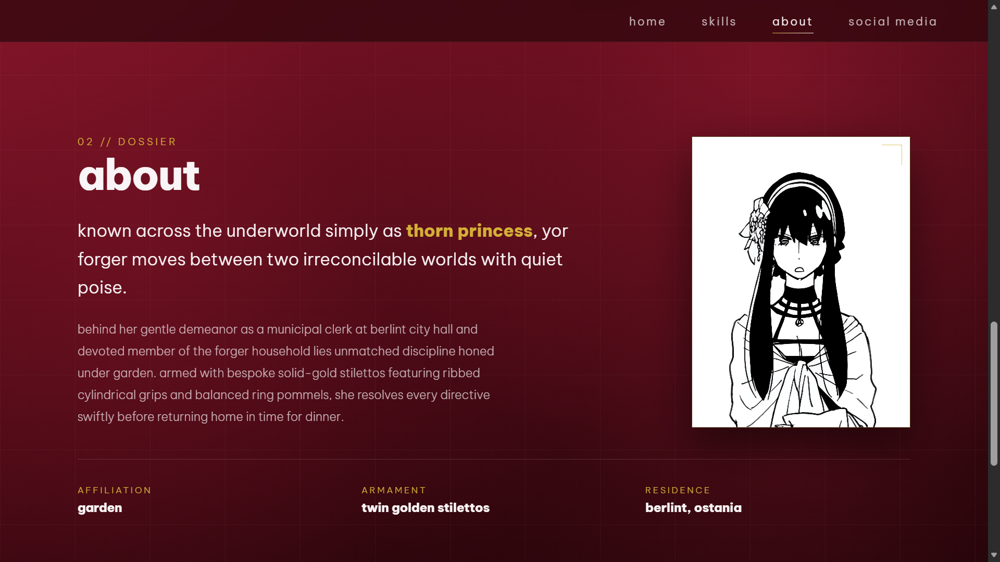
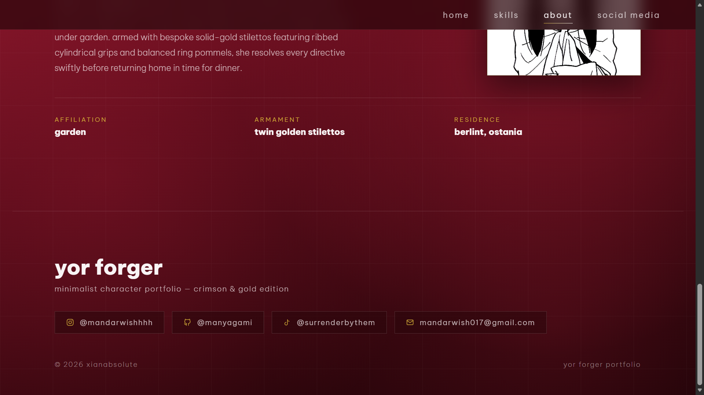

# yor forger — minimalist portfolio

A modern, minimalist single-page character portfolio inspired by **Yor Forger (Thorn Princess)** from *Spy × Family*. Designed with a layered crimson-to-burgundy palette (`#9E1B32` → `#2B050B`), crisp off-white typography (`#F9F4F5`), subtle gold accents (`#D4AF37`), and an interactive 3D weapon showcase.

---

## Preview

### Home
Slanted parallelogram hero frame, parallel scrolling marquee, mouse-parallax character focal point (`home.png`), and clean typographic hierarchy.



---

### Skills & 3D Weapon Showcase
Two-column split featuring a minimalist numbered skills list on the left and a 360° interactive Three.js weapon viewport on the right (supports `.glb`, `.obj`/`.mtl`, and an automatic procedural golden stiletto fallback).



---

### About
Two-column dossier layout pairing minimalist biography text and affiliation metadata with a framed portrait (`forger.png`).



---

### Social Media
Minimalist footer navigation with direct links to social handles and email.



---

## Built With

- **HTML5** — Semantic single-page structure
- **CSS3** — Custom properties, slanted `skewX` geometry, CSS keyframe marquee, responsive Grid & Flexbox
- **JavaScript (ES6)** — Scroll-spy navigation, mobile drawer, mouse-parallax effects, image fallbacks
- **[Three.js (r147)](https://threejs.org/)** — Interactive WebGL 3D showcase with:
  - `OrbitControls` (360° drag/touch rotation + idle auto-rotate)
  - `GLTFLoader` (`.glb` / `.gltf` support)
  - `OBJLoader` & `MTLLoader` (`.obj` support)
  - Procedural metallic gold stiletto fallback & studio `PMREMGenerator` lighting
- **[Google Fonts](https://fonts.google.com/specimen/Be+Vietnam+Pro)** — `Be Vietnam Pro` (weights `200` Ultra Light to `800` Extra Bold)

---

## Project Structure

```text
├── index.html          # Main HTML document
├── style.css           # Stylesheet & responsive breakpoints
├── script.js           # UI logic & Three.js 3D scene/loader
├── home.png            # Hero character transparent PNG
├── forger.png          # About section portrait image
├── model.glb           # (Optional) Custom 3D model (.glb or .obj)
└── screenshots/        # README preview screenshots
    ├── ss1.png
    ├── ss2.png
    ├── ss3.png
    └── ss4.png

Quick Setup
1. Clone or download this repository.
2. Make sure home.png and forger.png are placed in the root folder.
3. (Optional) To load a custom .glb or .obj 3D file, update MODEL_TYPE and MODEL_PATH at the top of script.js and run the project with a local server (e.g. VS Code Live Server or npx serve .).
4. Open index.html in your browser.

Credits
Design & Development: @manyagami
Character Inspiration: Yor Forger (Spy × Family by Tatsuya Endo)
3D Engine: Three.js
Typography: Be Vietnam Pro

Connect
Instagram: @mandarwishhhh
GitHub: @manyagami
TikTok: @surrenderbythem
Email: mandarwish017@gmail.com
